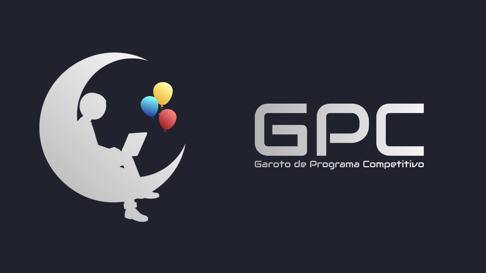
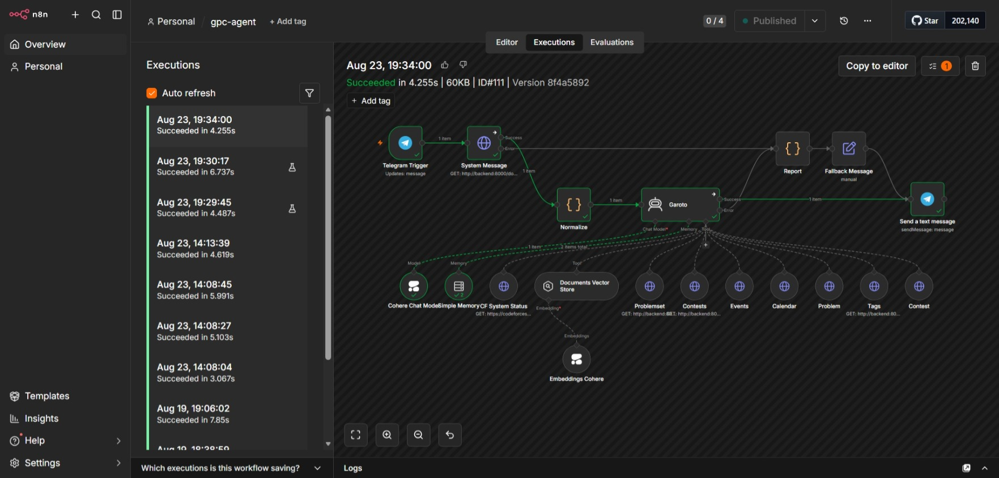
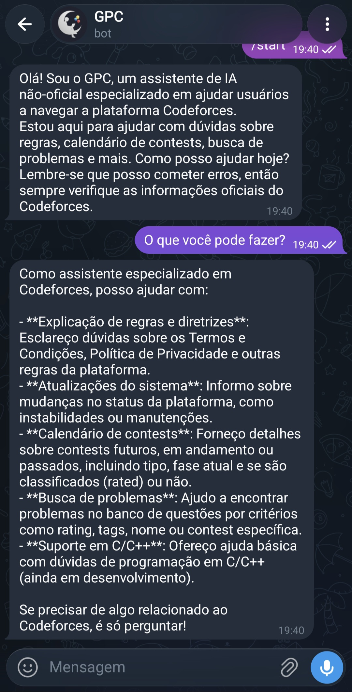
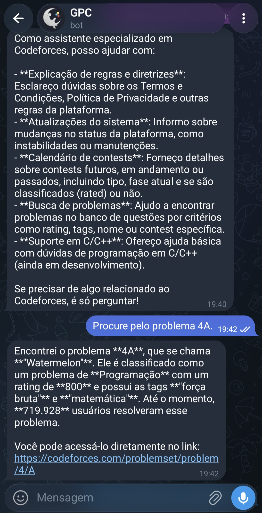
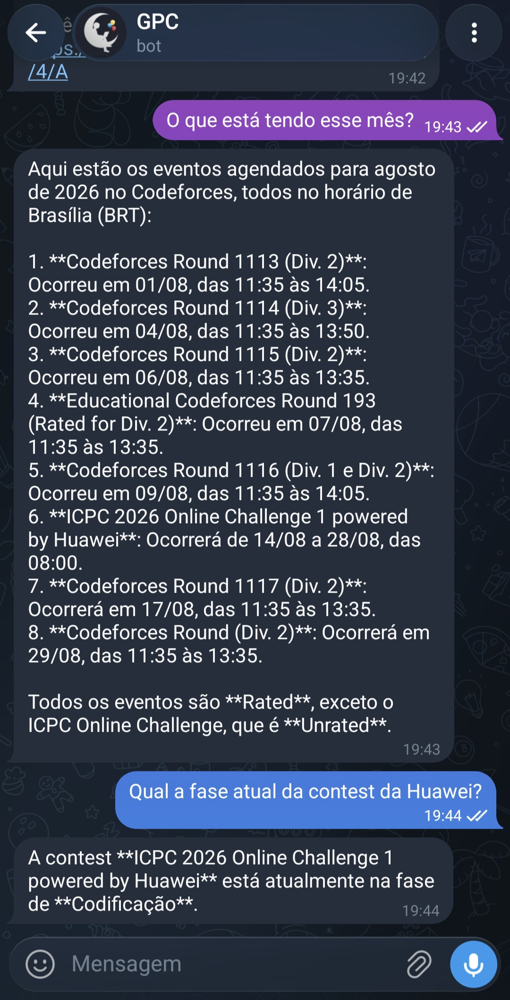

# GPC (Garoto de Programa Competitivo)


*(Design feito por @Dom-Henrique)*

Assistente de IA não oficial para o ecossistema Codeforces — ajuda a explorar a
plataforma, tira dúvidas sobre suas regras e dá suporte a quem está mergulhando
em programação competitiva.

## O que o GPC já faz

- Responde perguntas sobre a plataforma Codeforces via chat, com memória de
  conversa
- Consulta o status do sistema do Codeforces em tempo real
- Responde dúvidas sobre Termos de Uso e Política de Privacidade, usando busca
  semântica (RAG) sobre o conteúdo oficial
- Consulta eventos da plataforma por meio da API do Google Calendar
- Permite consultar problemas e contests da plataforma de forma avançada
- Se apresenta com transparência: deixa claro que é um agente não-oficial e
  que pode errar

## Motivação

Sou do curso de Análise e Desenvolvimento de Sistemas do Instituto Federal do
Sertão Paraibano (IFSPB) — a divisão mais recente, desmembrada do IFPB.

O curso não costuma abordar isso diretamente, mas entrei na área de Programação
Competitiva desde o início. É uma área que ensina a interpretar e resolver
problemas por meio de soluções eficientes — e, na maioria das vezes,
descartáveis, já que não são pensadas para serem mantidas a longo prazo.

Se aprende praticando, e o Codeforces é uma plataforma de nível mundial, com
problemas, contests semanais e competições de peso como ICPC, SBC e OPI.

O GPC nasceu como forma de ajudar quem usa a plataforma — e como oportunidade
de aprender construindo, através do desafio da Oracle Next Education (ONE) em
parceria com a Alura.

## Status

Projeto desenvolvido para o Challenge Agente da Alura, em parceria com a
Oracle Next Education (ONE).

Agente está hospedado na AWS, você pode experimentar no Telegram: @gpc14_bot



## Não afiliação e transparência

O GPC **não é afiliado, endossado ou mantido pelo Codeforces** ou pela
CODEFORCES GLOBAL FZCO. É um projeto pessoal e independente.

Este projeto utiliza IA e pode cometer erros ou apresentar conteúdo
desatualizado. Para decisões importantes, sempre confira as fontes oficiais:

- Termos e Condições: https://codeforces.com/terms
- Política de Privacidade: https://codeforces.com/privacy
- Ajuda / FAQ: https://codeforces.com/help

Texto completo do aviso local: `backend/assets/docs/disclaimer.md`

## Arquitetura (visão geral)

O projeto possui dois serviços principais via Docker Compose:

- **`backend`** (FastAPI) em `:8000` — serve de suporte ao agente, buscando, normalizando
  e servindo documentos e demais dados.
- **`n8n`** em `:5678` — orquestra o agente de IA (GPC).
- **`caddy`** — disponível em ambiente de produção e é usado para fazer proxy reverso para o n8n.

### Agente (n8n)

O GPC é um agente de IA (modelo Cohere) com memória de conversa, acessível via
chat (via API do Telegram), com as seguintes ferramentas disponíveis:

- Consulta de status do sistema Codeforces (`system.status`)
- Busca semântica (RAG) sobre Termos, Privacidade e o aviso de transparência
  do próprio projeto
- Consulta de eventos nos calendários da plataforma como a Programming Contests Calendar e
  Misc Codeforces Calendar
- Consulta dos problemas da paltaforma com suporte a pesquisa, ordenação e paginação.
- Consulta detalhada das contests da plataforma, também com filtros avançados.

### Fluxo de dados (backend)

O agente possui diversas fontes de dados, porém, devido as limitações da plataforma em fornecer
formas de pesquisa avançadas, inclusive, obter problemas de lá sempre retorna mais de 11 mil objetos,
o backend pega esses dados, normaliza e cacheia.

#### Documentos

1. `terms` e `privacy` são buscados de `codeforces.com`, quando dispara API REST.
2. O conteúdo HTML é filtrado e convertido para Markdown.
3. O resultado é armazenado em cache dentro de `.data`.
4. `disclaimer` é servido a partir de um arquivo local, sem busca externa.

#### Problemas e contests

1. Ao iniciar o servidor, um worker faz a sincronização em um certo intervalo.
2. Consiste em pegar todos os problemas e contests.
3. Normalizar usando os models do SQLAlchemy.
4. Inserir e/ou atualizar no banco de dados.

## Estrutura do repositório

```text
gpc
├── backend
│   ├── app
│   │   ├── api
│   │   │   ├── calendar.py
│   │   │   ├── contests.py
│   │   │   ├── docs.py
│   │   │   ├── problemset.py
│   │   │   └── tags.py
│   │   ├── models
│   │   │   ├── mdconvs
│   │   │   │   └── privacy.py
│   │   │   ├── sources
│   │   │   │   ├── cache.py
│   │   │   │   └── url.py
│   │   │   ├── transformers
│   │   │   │   ├── callable.py
│   │   │   │   ├── html_transformer.py
│   │   │   │   └── markdown.py
│   │   │   ├── calendar.py
│   │   │   ├── contest.py
│   │   │   ├── document.py
│   │   │   ├── event.py
│   │   │   ├── gapi.py
│   │   │   └── problemset.py
│   │   ├── services
│   │   │   ├── calendar_provider.py
│   │   │   ├── data_store.py
│   │   │   ├── db.py
│   │   │   ├── document_provider.py
│   │   │   ├── logging.py
│   │   │   ├── profiling.py
│   │   │   ├── secrets.py
│   │   │   └── worker.py
│   │   └── main.py
│   ├── assets
│   │   ├── docs
│   │   │   ├── disclaimer.md
│   │   │   ├── privacy.md
│   │   │   ├── system_message.md
│   │   │   ├── tags.json
│   │   │   └── terms.md
│   │   └── README.md
│   ├── Dockerfile
│   ├── pyproject.toml
│   ├── requirements.txt
│   └── requirements-dev.txt
├── calibration
├── scripts
│   ├── copy_workflows.py
│   └── envgen.py
├── workflows
│   ├── gpc-agent.json
│   └── gpc-docs.json
├── Caddyfile
├── docker-compose.prod.yml
├── docker-compose.yml
├── Makefile
└── README.md
```

## Tecnologias usadas

As principais tecnologias e ferramentas usadas neste projeto incluem:

- Python 3.12
- FastAPI (backend web framework)
- Uvicorn (ASGI server)
- SQLite (banco de dados)
- SQLAlchemy (ORM)
- requests (cliente HTTP)
- Pydantic (validação de dados)
- BeautifulSoup4 (parser de HTML)
- markdownify (conversor de HTML para Markdown)
- Google APIs (integração com o Calendário)
- tzdata (informações de fuso horário)
- psutil (métricas de % de CPU e RAM)
- n8n (automação/workflows)
- Docker e Docker Compose
- Cloudflare Tunnel (para testes localhost)
- Deploy na Amazon Web Services (AWS)
- make
- pylint

## Pré-requisitos

- Docker
- Docker Compose
- Python 3.12 (para desenvolvimento local do backend)
- `make` (opcional, mas recomendado)
- Se estiver rodando localhost, você precisará criar um túnel usando Cloudflare para criar uma URL pública.
  É dessa forma que a API do Telegram possa funcionar localmente.
- Se estiver em ambiente de produção (por exemplo, AWS ou OCI), certifique-se que haja um endereço IP público,
  de preferência fixo, e um provedor DNS.

### Setup do Túnel Cloudflare

1. Crie ou entre na sua conta do Cloudflare;
2. Em seu dashboard, vá em **Protect & Connect > Networking > Tunnels**;
3. Clique em **Create Tunnel**;
4. Siga as instruções como inserir nome e instalar o cloudflared;
5. Abra o terminal e digite `cloudflared tunnel --url http://localhost:5678`;
6. O Cloudflare vai lher dar uma URL a cada execução do cloudflared.
  ```
  +--------------------------------------------------------------------------------------------+
  |  Your quick Tunnel has been created! Visit it at (it may take some time to be reachable):  |
  |  https://XYZ.trycloudflare.com                                                             |
  +--------------------------------------------------------------------------------------------+
  ```

### Setup para produção (sugestão)

Você pode criar uma conta no [Duck DNS](https://www.duckdns.org/), adicionar um nome e associar o IP da instância pública.
Fica algo como `nome.duckdns.org`, então na etapa da produção, precisará configurar o Caddyfile para apontar para esse
endereço DNS.

### Antes do Docker subir...

É necessário que seja gerado um arquivo .env para que o n8n assuma um domínio.
Você pode chamar os comandos make abaixo e responda os prompts para gerar, ou
pode criar manualmente com base no template abaixo:

```
# Host
N8N_HOST=localhost
N8N_PROTOCOL=http
N8N_PORT=5678

# URLs
PUBLIC_URL=http://localhost:5678
WEBHOOK_URL=http://localhost:5678/
N8N_EDITOR_BASE_URL=http://localhost:5678

# Timezone
GENERIC_TIMEZONE=America/Sao_Paulo
```

O template acima já permite rodar n8n em ambiente local, caso esteja em produção e use
a sugestão acima:

```
# Host
N8N_HOST=nome.duckdns.org
N8N_PROTOCOL=https
N8N_PORT=5678

# URLs
PUBLIC_URL=https://nome.duckdns.org
WEBHOOK_URL=https://nome.duckdns.org/
N8N_EDITOR_BASE_URL=https://nome.duckdns.org

# Timezone
GENERIC_TIMEZONE=America/Sao_Paulo
```

(**Obs.:** No Cloudflare, apenas especifica o domínio, pois sempre ele vai refletir a porta 5678 do localhost.)

## Setup rápido (desenvolvimento)

Com `make`:

```bash
make setup
```

Esse alvo:

- cria o virtualenv em `backend/.venv`;
- instala dependências de `backend/requirements.txt`;
- instala dependências adicionais de `backend/requirements-dev.txt`
- instala o backend em modo editável (`pip install -e .`).

## Pylint

É possível rodar o Pylint para checar a sintaxe do código:

```bash
make pylint
```

## Executando com Docker

- .env é **requerido** para iniciar

Subir tudo:

```bash
make start
```

Subir apenas n8n:

```bash
make start-n8n
```

Subir apenas backend:

```bash
make start-backend
```

Parar tudo:

```bash
make stop
```

Tem também `stop-n8n` e `stop-backend`.

## ou caso queira testar apenas o servidor sem Docker

```bash
make server
```

## Produção

- .env é **requerido** para iniciar

No make:
```bash
make start-prod # Inicia
make stop-prod # Para
```

Usam a versão `docker-compose.prod.yml`, que é idêntica ao `docker-compose.yml` para n8n e backend,
apenas é adicionado um contêiner do Caddy para fazer proxy reverso ao n8n.

## Notas de inicialização

- Você pode usar a variável de ambiente `LOG_LEVEL` para definir a severidade dos logs;
- Garanta que .env esteja devidamente presente.

## Endpoints do backend

Base local esperada: `http://localhost:8000` (nos contêineres `http://backend:8000`)

- `GET /health` -> verificação de saúde
- `GET /docs/terms` -> termos do Codeforces
- `GET /docs/privacy` -> política de privacidade
- `GET /docs/disclaimer` -> aviso local do projeto
- `GET /docs/system_message` -> mensagem do sistema do agente
- `GET /api/calendar/primary` -> calendário "Programming Contests Calendar"
- `GET /api/calendar/misc` -> calendário "Misc Codeforces Calendar"
- `GET /api/calendar/all` -> todos os calendários
- `GET /api/calendar/{calendário}/events` -> eventos do calendário especificado
- `GET /api/problemset/problems` -> todos os problemas do Codeforces
- `GET /api/problemset/problems/{id¹}` -> um problema do Codeforces
- `GET /api/problemset/tags` -> todas as tags do Codeforces
- `GET /api/contests` -> todas as contests do Codeforces
- `GET /api/contests/{id²}` -> uma contest (ou concurso, se traduzir literalmente) do Codeforces

¹O ID de um problema é composto por duas partes:
  - ID da Contest: Um valor numérico como 4, 2251 etc.
  - Índice: Uma composição de letra e número para:
    - Indicar a posição naquela contest, como A, B, C...
    - Indicar a variação daquele problema.
    Por exemplo: A (primeiro problema), C2 (segunda variante do terceiro problema).
  - Com isso temos IDs como 4A, 2255E1, 1169B etc.

²O ID da contest é numérico, como descrito acima.

## Workflows do n8n

Arquivos versionados em:

- `workflows/gpc-agent.json`
- `workflows/gpc-docs.json`

Exportar workflows do container n8n para a pasta local:

```bash
make export-workflows
```

Observação: o processo usa `scripts/copy_workflows.py` para copiar e renomear
os arquivos com base no campo `name` do JSON.

Importar workflows:

```bash
make import-workflows
```

Note que terá que inserir manualmente quaisquer credenciais usados.

## Exemplos de perguntas e respostas

Confira alguns exemplos e demonstração:

<div align="center" style="display: flex; justify-content: center; gap: 16px; flex-wrap: wrap;">
  
  
  
</div>


> O que é a Política de Privacidade?
```markdown
A Política de Privacidade do Codeforces explica como os dados pessoais dos usuários são coletados, usados e protegidos. Aqui estão os principais pontos:

1. **Coleta de Dados**: Os dados pessoais podem ser fornecidos pelo usuário ou coletados automaticamente durante o uso da plataforma. Isso inclui o uso de cookies e outras ferramentas de rastreamento para identificar usuários e lembrar suas preferências.

2. **Uso de Dados**: Os dados são usados para fornecer os serviços solicitados pelo usuário. A falha em fornecer certos dados pode impedir que a plataforma funcione corretamente.

3. **Responsabilidade do Usuário**: Os usuários são responsáveis por quaisquer dados de terceiros que compartilhem através da plataforma.

4. **Divulgação de Dados**: O Codeforces pode ser obrigado a revelar dados pessoais a autoridades públicas, se solicitado.

5. **Informações Adicionais**: A plataforma pode fornecer informações adicionais sobre a coleta e processamento de dados pessoais, mediante solicitação.

6. **Logs do Sistema e Manutenção**: Para operação e manutenção, a plataforma e serviços de terceiros podem coletar logs de interação.

7. **Análise de Dados**: Ferramentas como o Google Analytics são usadas para monitorar e analisar o tráfego da web e o comportamento do usuário, às vezes compartilhando essas informações de forma agregada e anônima com terceiros.

8. **Geolocalização**: A plataforma pode coletar e usar dados de localização para fornecer serviços baseados em localização, desde que o usuário autorize explicitamente.

Recomendo verificar a Política de Privacidade oficial do Codeforces para obter informações completas e atualizadas.
```

> Procure pelo problema Watermelon
```markdown
Encontrei o problema **4A** com o nome "Watermelon". Ele tem um **rating de 800** e está associado às tags **brute force** e **math**.
```

> O que é a tag "brute force"?
```markdown
A tag **"brute force"** refere-se a problemas que podem ser resolvidos usando a técnica de **força bruta**, que envolve testar e iterar por todas as possibilidades possíveis de resposta até encontrar a solução correta. É uma abordagem direta, mas pode ser ineficiente para problemas grandes devido ao alto custo computacional.
```

> Qual a próxima contest do Codeforces?
```markdown
A próxima contest é o **Codeforces Round (Div. 2)**, que ocorrerá no dia **29 de agosto de 2026**, das **11:35 às 13:35**, no horário de Brasília. Ela é **Rated**.
```

> Determine o total de questões que nunca foram resolvidas no Codeforces.
```markdown
Aqui estão os problemas com a menor quantidade de resoluções:

- **1953A**: Accuracy-Preserving Summation Algorithm
- **1885A**: Deterministic Scheduling for Extended Reality over 5G and Beyond
- **1639K**: Treasure Hunt
- **1639J**: Treasure Hunt
- **1639I**: Treasure Hunt
- **1639H**: Treasure Hunt
- **1639G**: Treasure Hunt
- **1639F**: Treasure Hunt
- **1639E**: Treasure Hunt
- **1639D**: Treasure Hunt
- **1639C**: Treasure Hunt
- **1639B**: Treasure Hunt
- **1639A**: Treasure Hunt
- **1576A**: Communication Routing Challenge
- **1160A2**: Collaboration
- **92114**: Labyrinth-14
- **92113**: Labyrinth-13
- **92112**: Labyrinth-12
- **92111**: Labyrinth-11
- **92110**: Labyrinth-10
- **92109**: Labyrinth-9
- **92108**: Labyrinth-8
- **92107**: Labyrinth-7
- **92106**: Labyrinth-6
- **92105**: Labyrinth-5
- **92104**: Labyrinth-4
- **92103**: Labyrinth-3
- **92102**: Labyrinth-2
- **92101**: Labyrinth-1
- **775A**: University Schedule

Todos esses problemas têm **0 resoluções**.
```

> Houve alguma stream esse mês?
```markdown
Sim, houve as seguintes streams este mês:

1. **Stream: CF R 1113 (Div. 2) Upsolving**
   - **Data e Hora:** 1 de agosto de 2026, 14:15 (Horário de Brasília)
   - **Host:** Arpa

2. **Stream: CF R 1113 Solution Discussion**
   - **Data e Hora:** 1 de agosto de 2026, 14:15 (Horário de Brasília)
   - **Host:** aryanc403

3. **Stream: Easy CF Problems**
   - **Data e Hora:** 7 de agosto de 2026, 10:40 (Horário de Brasília)
   - **Host:** Errichto

4. **Stream: CF 1116 div1+2**
   - **Data e Hora:** 10 de agosto de 2026, 09:00 (Horário de Brasília)
   - **Host:** Errichto

5. **Stream: IOI Live Commentary day 1**
   - **Data e Hora:** 11 de agosto de 2026, 03:30 (Horário de Brasília)
   - **Host:** Errichto

6. **Stream: IOI Live Commentary day 2**
   - **Data e Hora:** 13 de agosto de 2026, 03:30 (Horário de Brasília)
   - **Host:** Errichto

7. **Stream: AC Beginner Contest 471 discussion**
   - **Data e Hora:** 15 de agosto de 2026, 10:45 (Horário de Brasília)
   - **Host:** Errichto

8. **Stream: AC Regular Contest 227 discussion**
   - **Data e Hora:** 16 de agosto de 2026, 11:05 (Horário de Brasília)
   - **Host:** Errichto

9. **Stream: Using AI to solve problems**
   - **Data e Hora:** 19 de agosto de 2026, 10:05 (Horário de Brasília)
   - **Host:** Errichto

10. **Stream: CSES Dynamic Programming part 3**
    - **Data e Hora:** 22 de agosto de 2026, 07:05 (Horário de Brasília)
    - **Host:** Errichto

11. **Stream: CSES Dynamic Programming part 4**
    - **Data e Hora:** 23 de agosto de 2026, 10:05 (Horário de Brasília)
    - **Host:** Errichto
```

## Limpeza do ambiente

```bash
make clean
```

Esse alvo remove virtualenv, cache Python, artefatos egg-info, recursos
Docker e quaiquer arquivos relacionados ao projeto.

## Troubleshooting

- Se `terms/privacy` falharem, valide conectividade e possíveis bloqueios
  externos.
- O backend depende de resposta HTTP do Codeforces para atualização desses
  documentos e demais dados.
- Em ambientes MSYS2 no Windows, há tratamento no `Makefile` para conversão
  de paths no export de workflows.

## Próximos passos

- [x] Consulta ao banco de questões por rating/tags e demais filtros
- [x] Consulta as contests
- [x] Calendário de contests usando Google Calendar API
- [x] Adicionar logging para o backend
- [x] deploy para AWS
- [99.9%] Calibração do agente¹
- [ ] Migrar para um modelo maior
- [ ] Busca de enunciados de cada problema
- [ ] FAQ, via API oficial e blogs do Codeforces
- [ ] Suporte a dúvidas de programação em C/C++

¹ A calibração foi feita com base no `calibration/round-1.md` e o processo é, para cada bloco:
1. Fazer o teste;
2. Anotar o fluxo interno, resultados e opinião;
3. Se houve problemas/imprecisões, faz a calibração e refaça os testes com problemas.

## Contato

Para dúvidas ou problemas, utilize:

- https://github.com/jppgmx/gpc
